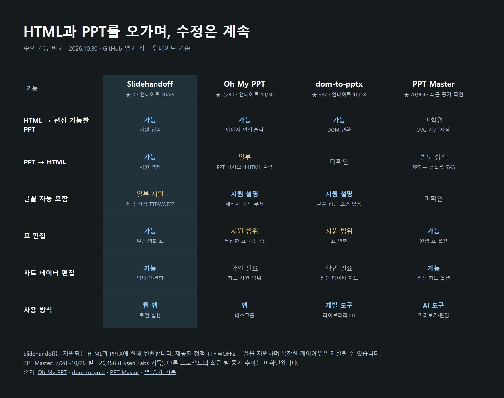

# Slidehandoff

**HTML과 PowerPoint 사이에서 이어서 작업하세요.**

HTML 발표 자료가 PPT 파일로 필요할 때, 또는 PowerPoint에서 수정한 내용을 HTML로 다시 쓸 때 사용합니다. 보고·발표·제출에 쓸 파일을 내려받고, 지원되는 문구와 숫자를 직접 수정할 수 있습니다.

지원되는 글자·기본 도형·표·차트는 PowerPoint에서 편집할 수 있습니다.

[시작하기](#시작하기) · [지원 범위](docs/supported-inputs.md) · [개발 안내](docs/development.md)


*HTML → PPT 초기 화면 예시입니다. 현재 화면에서는 PPTX도 선택할 수 있습니다.*

> **개발 미리보기입니다.** Windows에서 로컬 실행을 확인하고 있습니다. 아직 일반 사용자를 위한 설치 프로그램이나 판매 제품은 아닙니다. 변환 후 PowerPoint에서 글꼴, 줄바꿈과 겹침을 확인해 주세요.

## 주요 기능 비교



별 수는 2026년 10월 30일 기준이며, 다른 프로젝트의 기능은 공식 설명을 참고했습니다. 같은 입력으로 전체 품질을 비교한 결과는 아닙니다. [Oh My PPT](https://github.com/arcsin1/oh-my-ppt) · [dom-to-pptx](https://github.com/atharva9167j/dom-to-pptx) · [PPT Master](https://github.com/hugohe3/ppt-master)

## 시작하기

Windows, Node.js 24, Microsoft Edge가 필요합니다. PowerPoint는 내려받은 파일을 확인하고 수정할 때 사용합니다.

```sh
git clone https://github.com/Kyuhan1230/slidehandoff.git
cd slidehandoff
npm ci
npm start
```

브라우저에서 `http://127.0.0.1:42337`을 엽니다. 종료할 때는 실행한 터미널에서 `Ctrl+C`를 누릅니다. 다른 프로그램이 포트를 사용하면 종료한 뒤 다시 실행하세요.

## 사용 방법

1. HTML 또는 PPTX를 선택합니다. HTML에 필요한 이미지와 글꼴은 함께 선택합니다.
2. 미리보기와 지원 제한을 확인합니다.
3. 반대 형식의 파일을 내려받습니다. PPT는 PowerPoint에서 수정할 수 있습니다.

원본과 변환 결과는 개인 폴더에 보관하세요. 저장소에는 PPT와 입력용 HTML 예제 파일을 포함하지 않습니다. 자동 검사는 가상 자료를 메모리에서 만들어 실행합니다.

## 지금 할 수 있는 일

| 입력과 내용 | 출력 |
| --- | --- |
| 크기가 정해진 HTML 장표 | 원본 비율을 유지한 PPT |
| 장표 크기의 SVG | 장표 자동 탐색, 여러 장을 한 파일로 출력 |
| 지원되는 글자·기본 도형·선 | PowerPoint에서 수정 가능한 객체 |
| 일반·병합 표 | 셀과 행·열을 수정할 수 있는 PowerPoint 표 |
| 수치를 명시한 막대·꺾은선·원형 차트 | 데이터를 수정할 수 있는 PowerPoint 차트 |
| PNG·JPEG, 복잡한 SVG 장식 | 위치를 유지한 그림 객체 |
| 지원 범위의 PPTX | 현재 문구·표·차트 수치를 담은 HTML |

PPT에서 HTML을 만들고, 현재 HTML을 다시 PPT로 저장할 수 있습니다. 원래 PPT의 비율과 좌표를 기준으로 처리합니다. 모든 PPT와 웹페이지의 무손실 변환을 보장하지는 않습니다.

HTML 발표 자료의 클릭 동작, 애니메이션, 실시간 계산은 PPT로 옮기지 않습니다. 임의 스크립트를 실행하지 않으며, 복잡한 SVG는 그림으로 남을 수 있습니다. 함께 제공한 지원 정적 TTF·WOFF2 글꼴은 PPT에 포함할 수 있습니다. 가변 글꼴과 모든 CSS 효과·테마·줄바꿈의 동일한 재현은 지원하지 않습니다. [지원 범위](docs/supported-inputs.md)를 확인해 주세요.

## 문서를 다루는 방식

변환 서버는 이 컴퓨터의 루프백 주소에서 실행됩니다. 입력 HTML의 스크립트는 실행하지 않고, 렌더링 중 외부 요청은 차단합니다. 원본 파일을 덮어쓰지 않습니다.

브라우저 세션별로 작업 접근을 구분하고, 작업은 생성 후 30분에 만료됩니다. 화면에서 진행 중 작업을 취소하거나 보관된 작업을 삭제할 수 있습니다. 개인 로컬 실행용이며 인터넷 공개·다중 사용자 서비스의 보안 검증은 하지 않았습니다. [처리 범위와 남은 보안 과제](SECURITY.md)를 함께 확인해 주세요.

## 개발 방향

우선하는 일은 글자 누락과 겹침을 줄이고, 변환한 자료를 PowerPoint에서 이어서 다듬을 수 있게 만드는 것입니다. 혼자 만드는 보고서, 발표용 자료, PPT 제출과 동료에게 전달하는 상황을 함께 다룹니다. 시간 절감이나 사용자 만족도는 아직 측정하지 않았습니다.

[이 도구가 다루는 업무 문제](docs/workflow.md) · [구조와 개발 안내](docs/development.md) · [라이선스 안내](NOTICE.md)
