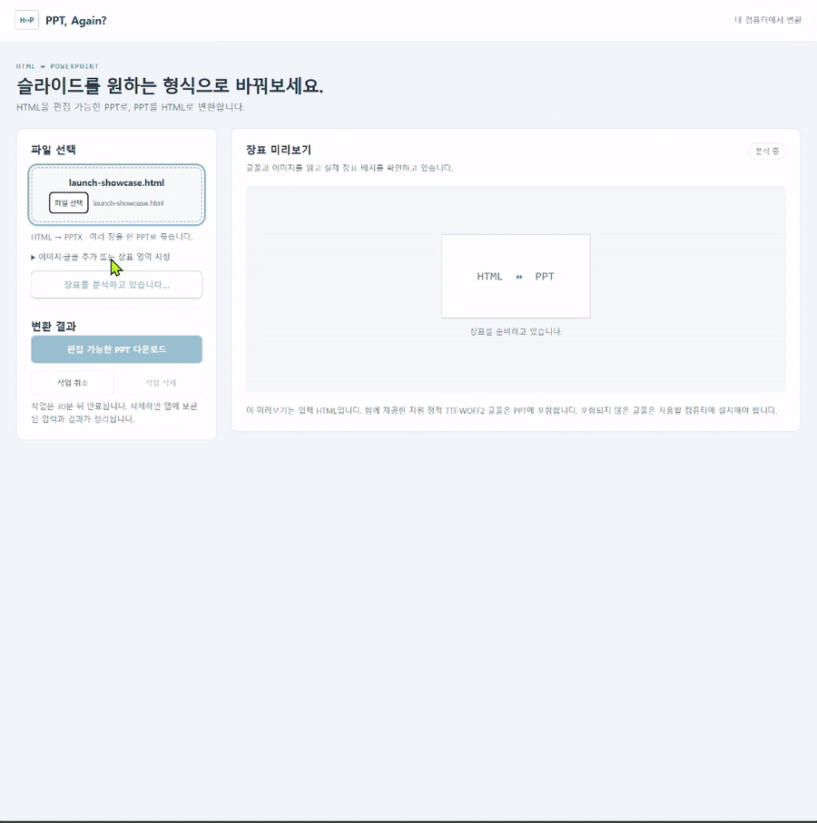
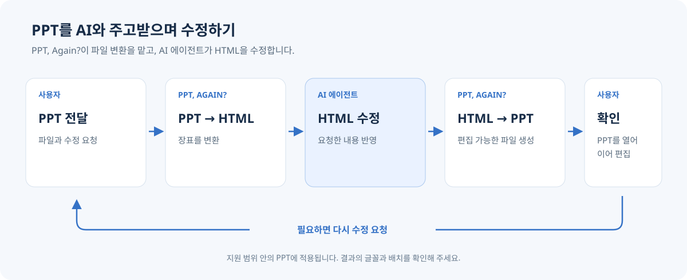
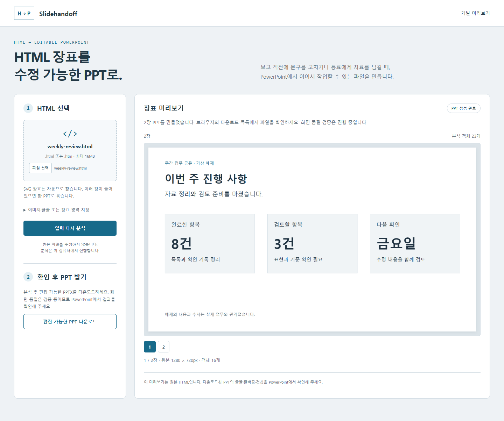

# PPT, Again?

**기존 PPT를 HTML로 고치고, 다시 PowerPoint에서 편집하세요.**

지원 범위의 PPT를 HTML로 바꿔 AI 에이전트와 함께 수정한 뒤, 다시 PPT로 만들 수 있습니다. HTML로 만든 장표도 편집 가능한 PPT로 변환할 수 있습니다.

변환한 파일은 PowerPoint에서 확인하고 수정하세요. 모든 문서의 글꼴, 줄바꿈과 서식이 원본과 같다고 보장하지는 않습니다.

**파일 변환 자체에는 AI 토큰이나 API 키가 필요하지 않습니다.** 변환은 내 컴퓨터에서 실행하고, 내용 수정에는 평소 쓰는 AI 에이전트를 사용할 수 있습니다. 에이전트가 자료를 읽고 수정할 때의 토큰과 비용은 사용하는 서비스에 따라 발생합니다.

지원되는 글자·기본 도형·표·차트는 PowerPoint에서 편집할 수 있습니다.

<p align="center">
  
</p>

<p align="center"><sub>개발 중인 버전의 HTML → PPT 변환 시연입니다.</sub></p>

[PPT 원본과 HTML 화면 비교 보기](https://github.com/Kyuhan1230/ppt-again/blob/85e52bbacf16a46c3fd605f831d1eed8cf052bb2/docs/images/pptx-html-pr3-comparison.png) · 가상 문서 7장의 비교입니다. 실제 회사 문서가 아니며, 모든 서식의 무손실 변환을 뜻하지 않습니다.

[AI 에이전트와 사용하기](#ai-에이전트와-사용하기) · [시작하기](#시작하기) · [지원 범위](docs/supported-inputs.md) · [시스템 구성도](docs/architecture/README.md)

> **개발 미리보기** · Windows에서 사용할 수 있습니다. 지원 범위와 변환 후 확인할 사항은 [지원 범위](docs/supported-inputs.md)를 참고하세요.

보고서의 **문자 글머리, 기본 숫자 목록, 문단 간격과 자간**은 지원되는 형태에서 양방향으로 옮깁니다. 표 셀에 들어 있는 일반 목록도 처리합니다. 그림 글머리와 로마자·알파벳 번호 등은 지원하지 않습니다. 브라우저와 PowerPoint의 글꼴 표시·줄바꿈 차이는 남을 수 있으므로 결과 파일을 비교해 주세요. [글머리와 간격의 지원 조건](docs/supported-inputs.md#글머리와-문단-간격)

## 사내 AI와 함께 쓰려면

회사에서 사용을 허용한 AI가 HTML을 만들 수 있다면, 생성한 HTML을 PPT로 변환해 볼 수 있습니다. 기존 CLI를 활용해 사내 AI의 보고서 생성 흐름에 연결하는 방법도 검토할 수 있지만, 사내 시스템 연동과 다중 사용자 환경은 별도 구현과 보안 검증이 필요합니다.

회사 자료를 AI에 입력하거나 다른 서비스로 옮길 때는 회사의 자료 분류와 사용 정책을 따르세요. 로컬 실행만으로 모든 보안 위험이 해결되는 것은 아닙니다.

## AI 에이전트와 사용하기

<p align="center">
  
</p>

예를 들어 에이전트에게 “이 PPT의 3번 장표 제목과 표의 수치를 바꾸고 PPT로 돌려줘”라고 요청할 수 있습니다. 에이전트는 다음 순서로 작업합니다.

1. PPTX를 HTML로 변환합니다.
2. HTML에서 요청한 문구나 표의 수치를 수정합니다.
3. 수정한 HTML을 다시 PPTX로 변환해 전달합니다.
4. 사용자가 PowerPoint에서 결과를 확인하고 필요한 부분을 이어서 수정합니다.

HTML은 AI가 내용을 읽고 수정하기 좋은 작업 공간입니다. PPT, Again?은 변환을 맡고, 사용자가 선택한 AI 에이전트가 HTML 수정을 수행합니다. 브라우저용 HTML의 클릭 동작이나 애니메이션을 PPT에서 그대로 재현하지는 않습니다.

## 시작하기

Windows, Node.js 24, Microsoft Edge가 필요합니다. PowerPoint는 내려받은 파일을 확인하고 수정할 때 사용합니다.

```sh
git clone https://github.com/Kyuhan1230/ppt-again.git
cd ppt-again
npm ci
npm start
```

브라우저에서 `http://127.0.0.1:42337`을 엽니다. 종료할 때는 실행한 터미널에서 `Ctrl+C`를 누릅니다. 다른 프로그램이 포트를 사용하면 종료한 뒤 다시 실행하세요.

변환 오류와 서버 시작 오류는 `.local/logs/errors-YYYY-MM-DD.log`에 기록합니다. 파일의 날짜는 UTC 기준입니다. 로그 확인과 Windows 감시 오류 점검 방법은 [오류 로그와 Windows 자원 감시](docs/error-log-handoff.md)를 참고하세요.

## 웹 화면에서 사용하기

<p align="center">
  
</p>

*HTML → PPT 초기 화면 예시입니다. 현재 화면에서는 PPTX도 선택할 수 있습니다.*

1. HTML 또는 PPTX를 선택합니다. HTML에 필요한 이미지와 글꼴은 함께 선택합니다.
2. 미리보기와 지원 제한을 확인합니다.
3. 반대 형식의 파일을 내려받습니다. PPT는 PowerPoint에서 수정할 수 있습니다.

PPTX를 선택하면 현재 장표의 글자와 지원되는 객체를 HTML로 가져옵니다. 가져오기 전에 HTML 글꼴을 **원본 유지 / 맑은 고딕 / Pretendard** 중에서 선택할 수 있습니다. 글꼴 변경은 이름과 스타일에 적용되며 글꼴 설치나 원본과 같은 줄바꿈을 보장하지 않습니다. 선택한 대체 글꼴을 쓸 때 원본 내장 글꼴 파일은 포함하지 않습니다.

**지원되는 내용만 가져오기**를 선택하면 옮길 수 없는 객체·배경은 위치를 알 수 있는 표시 상자로 남기고, 나머지 내용은 HTML로 내려받습니다. 진단에 장표 번호와 객체 종류·이름, 원인을 표시합니다. 잘못된 파일 구조, 외부 참조, 압축 해제 한도 초과 등 안전성 오류는 부분 변환으로 우회하지 않습니다. 미리보기 실행이 안 되어도 안전하게 읽은 HTML은 내려받을 수 있지만, 화면 배치는 직접 확인해야 합니다.

PPTX는 **64MiB 이하**를 지원하며 파일을 고르는 화면에서 한도를 안내합니다.

 단색 테마 배경과 사각형으로 잘라낸 그림도 읽을 수 있습니다. 이 컴퓨터에 없는 글꼴이나 원본과 달라질 수 있는 문단 간격은 분석 결과에서 안내합니다. HTML을 다시 PPT로 변환할 때는 필요한 글꼴을 설치하거나 지원되는 글꼴로 바꿔 주세요.

원본과 변환 결과는 개인 폴더에 보관하세요. 저장소에는 PPT와 입력용 HTML 예제 파일을 포함하지 않습니다. 자동 검사는 가상 자료를 메모리에서 만들어 실행합니다.

## 검증하기

자동 검사는 `npm test`로 실행합니다. PowerPoint가 설치된 Windows에서는 아래 명령으로 가상 HTML과 PPTX를 실제 PowerPoint에서 열어 글머리, 문단 간격과 자간을 검사할 수 있습니다.

```powershell
$env:PPT_AGAIN_OFFICE_TEST = '1'
node --test tests/pptx-office-text-format.test.mjs
Remove-Item Env:PPT_AGAIN_OFFICE_TEST
```

이 검사는 가상 파일을 사용합니다. 회사 보고서 전체의 변환 품질을 보증하는 검사는 아닙니다.

## 명령어로 변환하기

위의 `npm ci`를 실행한 뒤 터미널이나 AI 에이전트에서 실행합니다. 명령어 이름은 `ppt-again`입니다. 기존 `slidehandoff` 명령어도 계속 사용할 수 있습니다. 변환을 위해 서버를 실행하거나 별도의 AI API 키를 설정할 필요는 없습니다. HTML 수정은 사용하는 AI 에이전트가 수행합니다.

```sh
npx --no-install ppt-again convert slides.html --output slides.pptx --json
npx --no-install ppt-again convert slides.pptx --output slides.html --json
npx --no-install ppt-again convert slides.html --output slides.pptx --assets ./assets --selector ".slide" --json
npx --no-install ppt-again --help
```

`--assets`에는 HTML에서 상대 경로로 참조하는 이미지·CSS·글꼴이 들어 있는 폴더를 지정합니다. 해당 폴더는 파일과 하위 폴더를 합쳐 최대 1,024개 항목까지 읽습니다. 지원되는 정적 TTF·WOFF2만 글꼴 포함 대상입니다. 기존 출력 파일은 덮어쓰지 않습니다. `--json`은 표준 출력에 결과 객체 하나를 내보내며 종료 코드는 성공 0, 변환 실패 1, 사용법 오류 2입니다. 원본 스크립트는 실행하지 않고 외부 자산은 내려받지 않습니다. 복잡한 내용은 변환이 거부될 수 있습니다.

## 지금 할 수 있는 일

| 입력과 내용 | 출력 |
| --- | --- |
| 크기가 정해진 HTML 장표 | 원본 비율을 유지한 PPT |
| 장표 크기의 SVG | 장표 자동 탐색, 여러 장을 한 파일로 출력 |
| 지원되는 글자·기본 도형·선 | PowerPoint에서 수정 가능한 객체 |
| 일반·병합 표 | 셀과 행·열을 수정할 수 있는 PowerPoint 표 |
| 수치를 명시한 막대·꺾은선·원형 차트 | 데이터를 수정할 수 있는 PowerPoint 차트 |
| PNG·JPEG, 복잡한 SVG 장식 | 위치를 유지한 그림 객체 |
| 지원 범위의 PPTX | 현재 문구·표·차트 수치를 담은 HTML |

PPT에서 HTML을 만들고, 현재 HTML을 다시 PPT로 저장할 수 있습니다. 원래 PPT의 비율과 좌표를 기준으로 처리합니다. 모든 PPT와 웹페이지의 무손실 변환을 보장하지는 않습니다.

HTML 발표 자료의 클릭 동작, 애니메이션, 실시간 계산은 PPT로 옮기지 않습니다. 임의 스크립트를 실행하지 않으며, 복잡한 SVG는 그림으로 남을 수 있습니다. 함께 제공한 지원 정적 TTF·WOFF2 글꼴은 PPT에 포함할 수 있습니다. 가변 글꼴과 모든 CSS 효과·테마·줄바꿈의 동일한 재현은 지원하지 않습니다. [지원 범위](docs/supported-inputs.md)를 확인해 주세요.

<details>
<summary>다른 도구와 비교 (2026년 10월 30일 기준)</summary>

**어떤 도구인가요?**

| 프로젝트 | GitHub 별 ★ | 주로 하는 일 |
| --- | ---: | --- |
| **PPT, Again?** | 0 | HTML ↔ PPT 변환 · 웹 앱과 CLI |
| [Oh My PPT](https://github.com/arcsin1/oh-my-ppt) | 2,240 | AI로 HTML 장표 제작 · 데스크톱 앱 |
| [dom-to-pptx](https://github.com/atharva9167j/dom-to-pptx) | 387 | HTML을 PPT로 변환 · 라이브러리와 CLI |
| [PPT Master](https://github.com/hugohe3/ppt-master) | 70,964 | AI로 편집 가능한 PPT 제작 |

**우리가 특히 중요하게 보는 기능은요?**

| 프로젝트 | HTML → PPT | PPT → HTML | 표·차트 편집 |
| --- | --- | --- | --- |
| **PPT, Again?** | 지원 입력 | 지원 객체 | 일반·병합 표와 막대·선·원형 차트 |
| Oh My PPT | 앱에서 편집·출력 | 가져오기·HTML 출력 일부 | 표 개선 중 · 차트 범위 미확인 |
| dom-to-pptx | DOM 변환 | 미확인 | 표 변환 · 차트 범위 미확인 |
| PPT Master | 미확인 | 별도 SVG 형식 | 원생 표·차트 옵션 |

**글꼴 포함:** PPT, Again?은 제공된 정적 TTF·WOFF2 일부를 지원합니다. Oh My PPT와 dom-to-pptx도 글꼴 포함을 안내하며, dom-to-pptx는 글꼴 접근 조건이 있습니다. PPT Master는 미확인입니다.

별 수와 경쟁 도구 기능은 **2026년 10월 30일 기록 기준**입니다. PPT Master는 2026년 7월 28일~10월 25일 별이 26,456개 늘었습니다. 다른 도구의 증가 추이는 확인하지 않았습니다. [별 증가 기록](https://hysenlabs.com/projects/hugohe3-ppt-master)

기능은 각 프로젝트의 공식 설명을 참고했습니다. 같은 자료로 출력 품질을 비교한 결과는 아니며, “미확인”은 지원하지 않는다는 뜻이 아닙니다.

</details>

## 문서를 다루는 방식

변환은 이 컴퓨터에서 실행되며, 웹 화면은 이 컴퓨터에서만 접속할 수 있습니다. 입력 HTML의 스크립트는 실행하지 않고, 렌더링 중 외부 요청은 차단합니다. 원본 파일을 덮어쓰지 않습니다.

브라우저 세션별로 작업 접근을 구분하고, 작업은 생성 후 30분에 만료됩니다. 화면에서 진행 중 작업을 취소하거나 보관된 작업을 삭제할 수 있습니다. 개인 로컬 실행용이며 인터넷 공개·다중 사용자 서비스의 보안 검증은 하지 않았습니다. [처리 범위와 남은 보안 과제](SECURITY.md)를 함께 확인해 주세요.

## 라이선스

[MIT 라이선스](LICENSE)로 제공됩니다. 사용한 외부 코드와 의존성의 조건은 [라이선스 안내](NOTICE.md)를 확인해 주세요.
