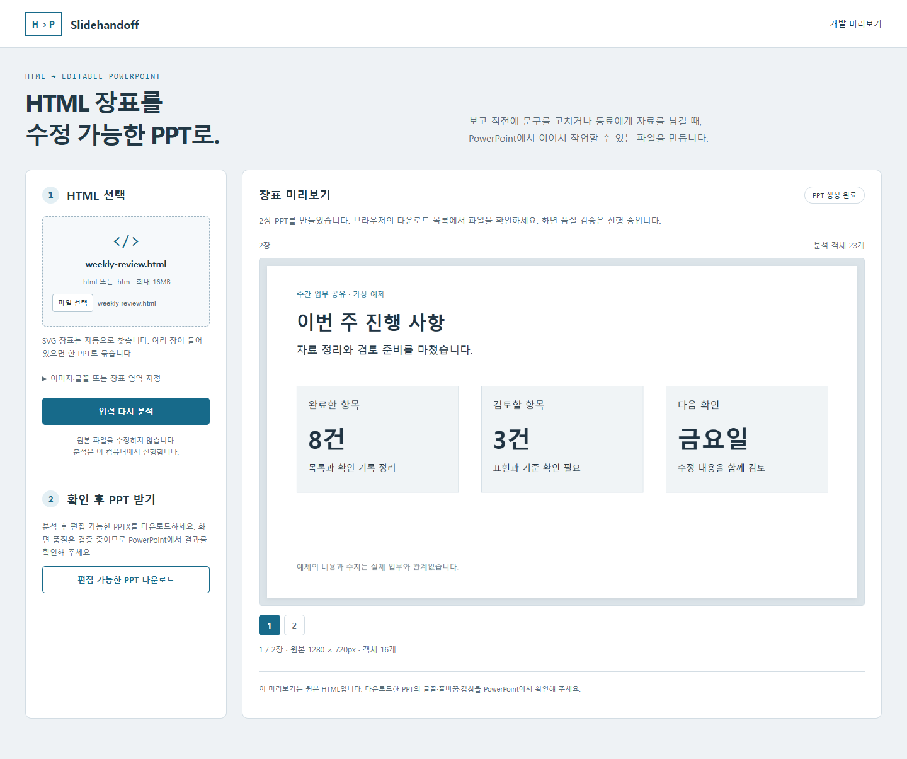

# Slidehandoff

**HTML로 만든 장표를, 동료가 고칠 수 있는 PPT로.**

보고 직전에 숫자가 바뀌거나 자료를 넘겨받은 동료가 문구를 고쳐야 할 때가 있습니다. 장표가 이미지로만 남아 있으면 작은 수정도 다시 만들어야 합니다.

Slidehandoff는 HTML 장표를 읽어 PowerPoint에서 수정할 수 있는 `.pptx` 파일로 바꿉니다. 지원되는 글자·기본 도형·선은 각각의 객체로 남습니다.



> **개발 미리보기입니다.** Windows에서 로컬 실행을 확인하고 있습니다. 아직 일반 사용자를 위한 설치 프로그램이나 판매 제품은 아닙니다. 변환 후 PowerPoint에서 글꼴, 줄바꿈과 겹침을 확인해 주세요.

## 사용 방법

1. 장표 HTML을 선택합니다. 필요한 이미지와 글꼴은 함께 선택합니다.
2. 미리보기와 지원 제한을 확인합니다.
3. PPT를 내려받아 PowerPoint에서 수정합니다.

처음에는 [가상 주간 보고](examples/weekly-review.html)로 확인해 보세요. 일정과 인계 메모 예제도 [examples](examples)에 있습니다. 실제 회사 자료는 예제에 사용하지 않았습니다.

## 지금 할 수 있는 일

| 입력과 내용 | 출력 |
| --- | --- |
| 크기가 정해진 HTML 장표 | 원본 비율을 유지한 PPT |
| 장표 크기의 SVG | 장표 자동 탐색, 여러 장을 한 파일로 출력 |
| 지원되는 글자·기본 도형·선 | PowerPoint에서 수정 가능한 객체 |
| PNG·JPEG, 복잡한 SVG 장식 | 위치를 유지한 그림 객체 |

임의 웹사이트, 스크립트 실행이 필요한 화면, 모든 CSS 효과를 변환하는 도구는 아닙니다. 복잡한 SVG는 그림으로 남을 수 있습니다. 표·차트의 데이터 편집과 모든 글꼴의 동일한 재현은 지원을 보장하지 않습니다. [지원 범위](docs/supported-inputs.md)를 확인해 주세요.

## 로컬에서 실행하기

Windows, Node.js 24, Microsoft Edge가 필요합니다. PowerPoint는 내려받은 파일을 확인하고 수정할 때 사용합니다.

```sh
git clone https://github.com/Kyuhan1230/slidehandoff.git
cd slidehandoff
npm ci
npm start
```

브라우저에서 `http://127.0.0.1:42337`을 엽니다. 종료할 때는 실행한 터미널에서 `Ctrl+C`를 누릅니다. 다른 프로그램이 포트를 사용하면 종료한 뒤 다시 실행하세요.

## 문서를 다루는 방식

변환 서버는 이 컴퓨터의 루프백 주소에서 실행됩니다. 입력 HTML의 스크립트는 실행하지 않고, 렌더링 중 외부 요청은 차단합니다. 원본 파일을 덮어쓰지 않습니다.

현재는 사용자 인증과 작업별 접근 권한이 없는 개인 로컬 실행용입니다. 서버를 인터넷에 연결하거나 여러 사람이 공유하는 서비스로 사용하지 마세요. 작업은 메모리에 보관되며, 30분이 지난 작업은 다음 요청 때 정리됩니다. 서버를 종료하면 앱의 작업 메모리도 해제됩니다. [처리 범위와 남은 보안 과제](SECURITY.md)를 함께 확인해 주세요.

## 개발 방향

우선하는 일은 글자 누락과 겹침을 줄이고, 파일을 받은 사람이 후속 수정을 할 수 있게 만드는 것입니다. 시간 절감이나 사용자 만족도는 아직 측정하지 않았습니다.

[이 도구가 다루는 업무 문제](docs/workflow.md) · [구조와 개발 안내](docs/development.md) · [라이선스 안내](NOTICE.md)
