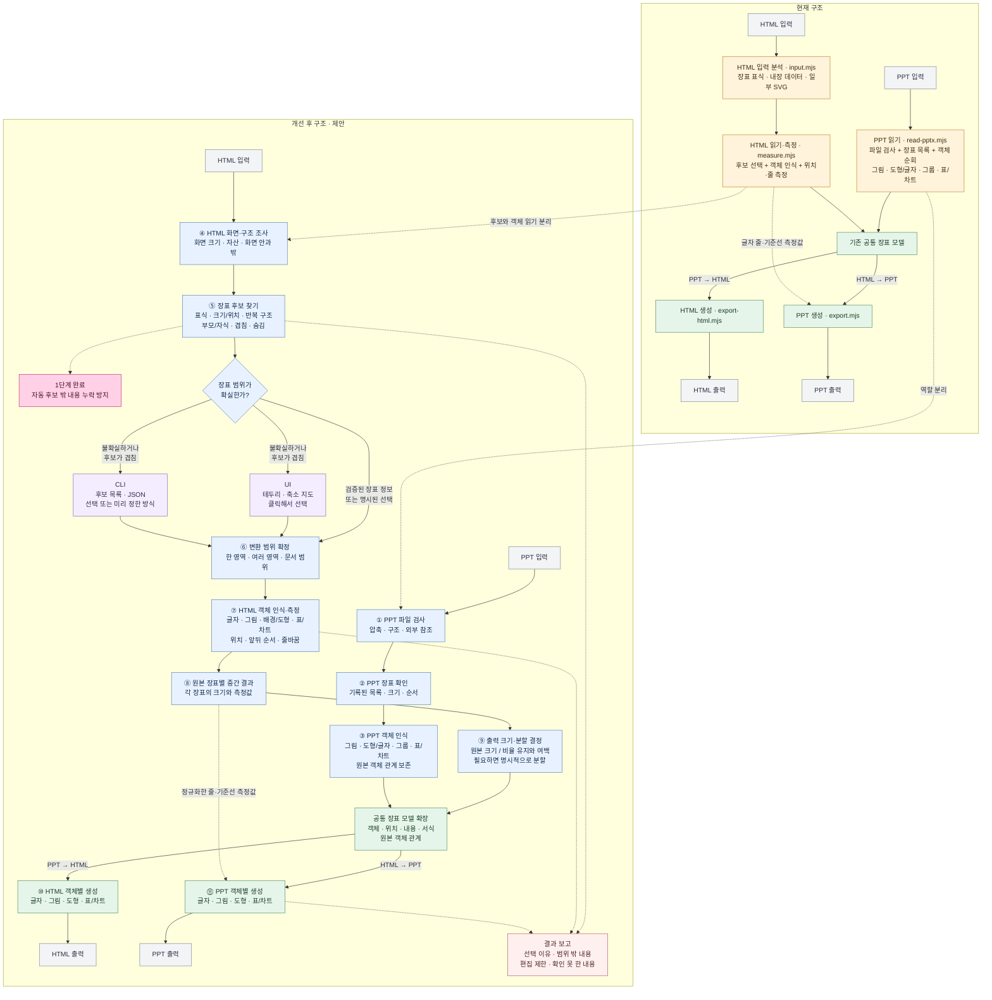

# PPT ↔ HTML 리팩토링 진행도

아래 그림은 요청받은 원본 구조다. 분홍색은 해당 역할의 구현과 검증이 끝난 부분만 표시한다. 일부만 끝난 역할은 전체 노드를 칠하지 않고 세부 진행 표에 기록한다.

| 단계 | 상태 | 완료 범위 |
|---|---|---|
| 1. 영역 밖 내용 누락 방지 | 완료 | 자동 선택은 범위 밖 내용이 발견되면 오류, 명시 선택은 경고; 확인하지 못한 내용은 별도 알림 |
| 2. 후보 조사 | 대기 | 후보·관계·화면 안팎 조사 |
| 3. UI·CLI 선택 | 대기 | 동일 후보 표시 및 선택 |
| 4. HTML 객체 인식 분리 | 대기 | 글자·그림·도형·표/차트 분리 |
| 5. 원본 객체 관계 보존 | 대기 | PPT 한 객체의 왕복 보존 |
| 6. PPT 읽기 분리 | 대기 | 파일 검사·장표·객체 읽기 분리 |
| 7. 양쪽 생성기 분리 | 대기 | HTML·PPT 객체별 출력 |
| 8. 가변 크기 | 대기 | 장표별 중간 결과와 크기 정규화 |
| 9. 문서 분할 | 대기 | 명시적 페이지 분할 |
| 10. 통합 검증 | 대기 | 양방향·UI·CLI·지원 제한 확인 |
## 1단계 검토

자동으로 선택된 장표 밖에 표시된 내용이 있으면 변환을 중단한다. 사용자가 영역을 명시한 경우에는 선택한 영역을 유지하고 경고한다. 숨겨진 내용이나 CSS 합성 등 조사하지 못한 내용은 별도로 알린다. 화면 크기 변경 전후의 관측 결과를 함께 사용한다.

검증: 변경 전 실패 사례를 확인한 뒤 범위 밖 내용, 화면 크기 변경, 배경 및 기존 장표 입력에 대한 집중 테스트 80개를 모두 통과했다. 독립 검토에서 문서 배경과 반응형 화면의 누락을 재현하고 수정 후 다시 확인했다. Windows 전체 테스트는 이 단계 PR의 CI에서 확인한다.

남은 한계: 복잡한 CSS 합성과 스크립트로 생성되는 내용은 완전하게 판정할 수 없다. 다음 단계에서 장표 후보와 범위를 별도로 조사한다.
