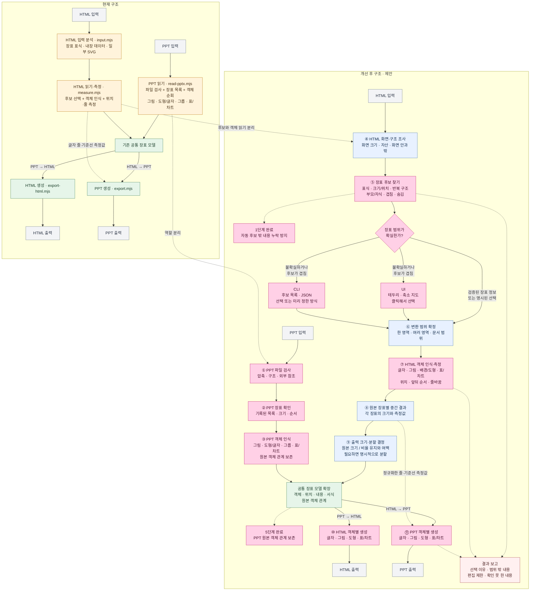

# PPT ↔ HTML 리팩토링 진행도

아래 그림은 요청받은 원본 구조다. 분홍색은 해당 역할의 구현과 검증이 끝난 부분만 표시한다. 일부만 끝난 역할은 전체 노드를 칠하지 않고 세부 진행 표에 기록한다.

| 단계 | 상태 | 완료 범위 |
|---|---|---|
| 1. 영역 밖 내용 누락 방지 | 완료 | 표식 없는 HTML은 선택 요구; 명시 선택의 바깥 내용은 경고하고 보존 불가한 겹침은 차단 |
| 2. 후보 조사 | 완료 | 후보·관계·화면 안팎 및 확인 한계 조사 |
| 3. UI·CLI 선택 | 완료 | 같은 후보를 UI·CLI에서 선택하고 가능한 범위를 PPT로 변환 |
| 4. HTML 객체 인식 분리 | 완료 | 한 번의 공통 순회를 유지하며 글자·그림/도형·표·차트 처리 분리 |
| 5. 원본 객체 관계 보존 | 완료 | 글자·배경·선이 하나인 PPT 도형의 관계와 현재 수정값 보존 |
| 6. PPT 읽기 분리 | 완료 | 파일 검사·장표 준비·공통 순회와 종류별 읽기 분리 |
| 7. 양쪽 생성기 분리 | 완료 | 공통 순서·객체 ID를 유지하며 HTML·PPT 종류별 출력 분리 |
| 8. 가변 크기 | 대기 | 장표별 중간 결과와 크기 정규화 |
| 9. 문서 분할 | 대기 | 명시적 페이지 분할 |
| 10. 통합 검증 | 대기 | 양방향·UI·CLI·지원 제한 확인 |
## 1단계 검토

1단계에서는 자동으로 선택된 장표 밖에 표시된 내용이 있으면 변환을 중단하도록 했다. 2단계부터 표식 없는 일반 HTML은 자동 확정 대신 선택이 필요하다고 중단한다. 사용자가 영역을 명시한 경우에는 선택한 영역을 유지하고 경고한다. 숨겨진 내용이나 CSS 합성 등 조사하지 못한 내용은 별도로 알린다. 화면 크기 변경 전후의 관측 결과를 함께 사용한다.

검증: 변경 전 실패 사례를 확인한 뒤 범위 밖 내용, 화면 크기 변경, 배경 및 기존 장표 입력에 대한 집중 테스트 80개를 모두 통과했다. 독립 검토에서 문서 배경과 반응형 화면의 누락을 재현하고 수정 후 다시 확인했다. 이 단계 PR의 Windows 전체 CI도 통과했다.

남은 한계: 복잡한 CSS 합성과 스크립트로 생성되는 내용은 완전하게 판정할 수 없다. 다음 단계에서 장표 후보와 범위를 별도로 조사한다.

## 2단계 검토

HTML을 별도로 조사해 개별 영역과 선택 가능한 묶음을 나누고, 근거·부모와 자식·겹침·화면 밖과 숨김·범위 밖 내용 및 확인 한계를 기록한다. 표식 없는 일반 HTML은 한 장으로 임의 확정하지 않는다. 입력·자산·화면과 배치가 달라졌거나 검증이 불가능하면 새 작업자에서 기존 선택을 거부한다.

검증: 후보 조사·영역 안전·입력 안전·SVG의 순차 테스트 116개가 통과했다. 독립 검토에서 돌출과 잘림, 중복 후보, 명시 선택, 수백 개의 장표 내부 객체, 작은 화면 밖 영역과 자산 변경을 재현했다. 이 단계 PR의 Windows 전체 CI도 통과했다.

2단계 당시에는 실제 변환 연결이 남아 있어 모든 선택지를 변환 미연결로 표시했다. 3단계에서 UI·CLI 선택, 작업 소유권과 실제 측정 화면 재검증을 연결했다. 스크립트·숨김·복잡한 CSS와 조사 한도는 결과에 별도로 알린다.

## 3단계 검토

UI는 전체 축소 보기와 후보 경계, 관계, 화면 밖·숨김과 확인 한계를 보여준다. CLI는 후보 목록과 JSON을 조회하고 저장된 후보 또는 명시 범위를 선택한다. 선택된 화면은 새 작업자에서 다시 확인해 같은 화면에서 측정한다. UI와 CLI에서 같은 입력과 후보를 선택했을 때 같은 PPT 장표가 만들어지는 것도 확인했다.

검증: UI와 기존 양방향 UI 26개, 서버·선택·후보·안전성 133개, CLI와 기존 CLI 16개가 통과했다. 독립 검토에서 다른 사용자 접근, 취소·만료와 작업 정리, 오래된 다운로드 차단, 응답 직전 취소, 반응형 배치, 배경과 겹침 보존 여부를 확인했다. 이 단계 PR의 Windows 전체 CI도 통과했다.

남은 한계: 서로 다른 크기와 겹친 영역 등 현재 측정기가 지원하지 않는 선택은 이유를 표시하고 출력을 막는다. 여러 장의 다른 크기와 분할은 8·9단계에서 처리한다. Windows 직렬 통합 테스트의 기존 실행 시간이 14분을 넘고 테스트가 추가돼 CI 시간 제한을 35분으로 늘렸다.

## 4단계 검토

장표 안을 한 번 순회하며 객체의 위치와 순서를 관리하고, 글자·그림/도형·표·차트 읽기를 종류별 함수로 분리했다. 기존 SVG·표·차트 처리와 표 셀 글자의 중복 방지, 앞뒤 순서는 유지한다.

기존에 조용히 빠지던 잘림·테두리·이미지 크롭·그림자·합성 등은 보존할 수 없는 경우 오류로 알린다. 투명 이미지에 지정한 단색 배경은 이미지 뒤의 편집 가능한 도형으로 보존한다. 장표 자체 경계 밖으로 나가는 정상 PPT 객체와 실제로 잘리지 않는 이미지는 유지한다.

검증: 신규 객체·SVG·표 테스트 67개와 PPT 왕복·문단·차트 테스트 67개가 통과했다. 여섯 종류의 기존 입력을 변경 전후 같은 브라우저에서 비교해 객체 모델·측정값·진단이 일치했다. 실제 PPT XML로 객체 순서와 시각적 누락 사례를 독립 검토했다. 이 단계 PR의 Windows 전체 CI도 통과했다.

남은 한계: 복잡한 잘림과 합성 등은 현재 편집 가능한 객체로 재현하지 못하면 변환을 중단한다. PPT 원본 객체 하나를 왕복할 때의 관계 보존은 5단계에서 다룬다.

## 5단계 검토

PPT 원본에서 글자·배경·선이 한 객체였다는 관계를 별도 버전 정보로 기록한다. HTML을 다시 읽을 때 관계와 현재 부모·위치를 확인하고, 가능한 경우 현재 글자·채움·선·모서리를 하나의 편집 가능한 PPT 도형으로 출력한다. 따로 이동하거나 관계가 잘못된 경우 현재 내용을 유지하며 분리 사실을 알린다.

검증: 원본 관계·글자 도형·PPT 왕복·중첩 그룹과 그림 대체 테스트 45개, 기존 PPT 글자·문단·오류 진단 테스트 59개가 통과했다. 실제 PPT XML로 객체 수·둥근 모서리·위치·글자 여백·0.25~2pt 선과 현재 CSS 수정값을 확인했다. 독립 검토에서 중복·잘못된 관계, 독립 이동, 그룹 객체 매핑과 표현할 수 없는 효과를 확인했다. 이 단계 PR의 Windows 전체 CI도 통과했다.

남은 한계: HTML 안의 관계 정보만으로 원본의 진위를 인증할 수는 없다. 이 정보로 글자나 색을 복원하지 않으며, 현재 HTML에서 표현을 읽는다. 복잡한 배경·테두리·반투명 합성을 보존하지 못하면 변환을 중단한다.

## 6단계 검토

PPT 파일과 관계 검사, 장표·마스터·레이아웃 준비, 공통 객체 순회, 그림·도형/글자 읽기를 나눴다. 표와 차트는 기존 처리기를 재사용한다. 파일 전체 관계 검사와 공유 압축 예산, 마스터→레이아웃→장표 순서, 오류 위치와 그룹 좌표를 유지한다.

검증: 계획된 기존 회귀와 새 경계 테스트를 합친 15개 파일에서 119개가 통과했고, 미사용 연결을 정리한 뒤 경계·치명 오류 17개를 다시 확인했다. 기존 코드와 분리된 코드의 네 입력에서 모델과 진단이 일치했다. 독립 검토에서 층별 중복 ID·잘못된 좌표의 오류 위치, 여러 장에 걸친 차트 점수 한도, 5단계 원본 관계를 확인했다. 이 단계 PR의 Windows 전체 CI도 통과했다.

원래 로컬의 미커밋 PPT 읽기 파일은 수정하지 않았다. 해당 파일을 통째로 덮어쓰지 않고 함수별로 비교했으며, 5단계의 원본 객체 관계는 유지했다.

## 7단계 검토

HTML과 PPT 생성기는 각각 공통 출력 순서·객체 번호·진단을 관리하고, 글자·도형·선·그림·표·차트를 종류별 함수로 만든다. PPT의 문단·그룹·프리셋·전환·글꼴 후처리 순서와 원본 텍스트 도형 관계도 유지한다.

HTML에서 빠지던 장표·도형 배경을 보존하고, 일반 투명 그림의 바탕색과 이미 합성된 캡처를 구분한다. 이미지의 해시·형식·구조와 캡처 크기, SVG 외부 참조를 양쪽 출력에서 검사한다.

검증: 생성기·배경·기존 PPT 왕복 관련 5개 파일에서 112개 테스트가 통과했다. 실제 브라우저 픽셀과 PPT XML로 투명도·그룹·자르기·객체 순서를 확인했고, 기존 혼합 PPT와 분리 후의 XML·객체 매핑·진단을 비교했다. 독립 보안·정확성 검토도 통과했다. Windows 전체 테스트는 이 단계 PR의 CI에서 확인한다.

남은 한계: JPEG는 구조를 검사하지만 압축된 픽셀을 완전히 해독하지는 않아 해당 배경에 경고를 표시한다. 캡처 정보와 이미지를 함께 위조한 경우 원본 출처의 진위는 인증할 수 없다.
