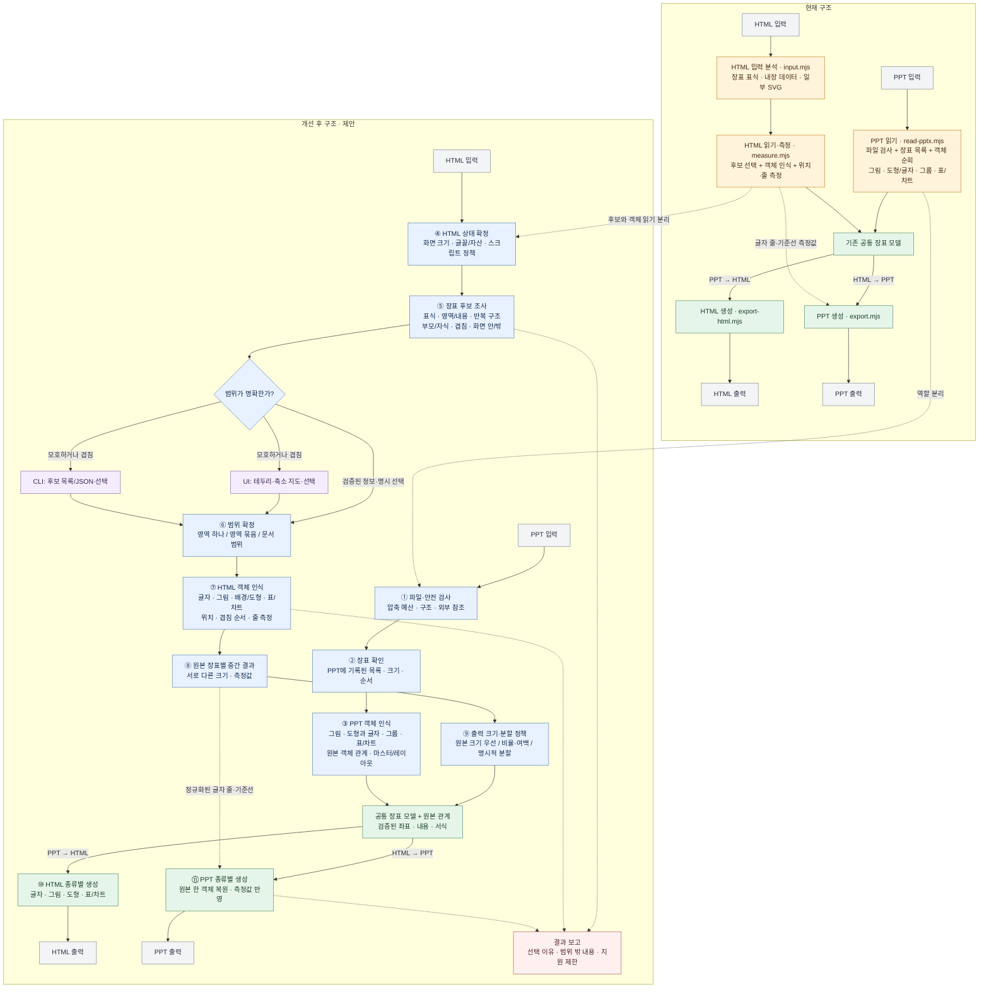

# PPT ↔ HTML 리팩토링 실행 계획

> **작업자:** 작업별로 검증하고, 실행 시에는 `executing-plans` 또는 `subagent-driven-development` 절차를 따른다. 체크박스는 구현 시 진행 상태를 표시한다.

**목표:** PPT 장표·객체 읽기와 HTML 장표 후보·객체 인식을 분리하고, 범위 누락과 원본 객체 분리를 사용자에게 숨기지 않는다.

**구조:** PPT는 파일의 장표 목록을 읽고, HTML은 같은 렌더링 상태에서 후보를 조사한 후 범위를 정한다. 양쪽의 객체를 기존 공통 모델로 전달하되 원본 객체 관계와 HTML 측정값을 보존한다. 미정인 후보는 UI/CLI에 보여주며 자동으로 장표라고 확정하지 않는다.

**기술:** Node.js 24, Playwright/Chromium, parse5, PptxGenJS, `node --test`.

**설계 근거:** 이 대화에서 합의한 PPT ↔ HTML 흐름과 후보·객체 인식 기준. 별도 확정된 설계 명세 파일은 없다.

## 현재와 개선 후: 양방향 전체 구조

노랑은 현재 섞여 있는 책임, 파랑은 분리·추가할 책임, 초록은 기존 기반을 재사용하는 부분이다. 아래 그림은 설계이며 개선 후 기능이 이미 구현됐다는 뜻은 아니다.



PPT에는 장표 목록이 있으므로 사진이나 화면의 크기로 추정하지 않는다. HTML의 `.slide`, `section`, 16:9 또는 스크롤 유무는 단독으로 정답이 아니다. UI·CLI가 같은 조사 결과를 사용하며, 화면 밖에 이미 로드된 영역과 숨김·미로드 내용은 구분한다.

## 빠졌던 네 가지 판단 기준

1. **범위와 장표 수:** `문서 전체`는 어디까지 읽는지이고 `한 장/여러 장`은 결과를 어떻게 나누는지다. 두 선택을 한 옵션으로 합치지 않는다.
2. **서로 다른 세 가지 겹침:** DOM 부모·자식 후보는 각각/묶음의 대안을 보여준다. 화면상 겹치는 형제 후보는 사용자에게 관계를 보여주고 독립 표현이 가능한지 검증한다. 선택된 장표 안의 사진·글자 겹침은 일반 객체 순서 문제로 처리한다.
3. **범위의 의미:** `DOM 요소` 선택은 해당 요소와 자손의 화면 기여를 대상으로 하고 CSS 잘림·부모 배경을 별도 분석한다. 자식이 영역 밖으로 나가거나 형제가 안쪽에 덮여 있어 원본 화면을 재현할 수 없다면 그 차이를 표시한다. `문서 범위` 선택은 별도 방식으로 전체 표시 영역을 읽으며, 숨김이나 내부 스크롤의 보이지 않는 내용이 모두 포함됐다고 주장하지 않는다.
4. **원본 한 객체와 HTML 복합 요소:** PPT 도형 하나에 배경과 글자가 있으면 관계를 보존한다. 일반 HTML `div`에 배경·문단·이미지가 있으면 도형·글자·그림으로 나눌 수 있다. 표의 셀 텍스트는 표 안에서 한 번만 읽고, 그림만 있는 차트에서 데이터를 추측하지 않는다.

### 후보와 객체: 구체적인 예

화면 안의 큰 패널에 작은 카드 세 개가 있고 카드 크기가 조금씩 다르다고 하자. 조사 결과는 `큰 패널 1개`, `카드 3개 묶음`, `각 카드`를 서로 관련된 후보로 제시한다. 큰 패널은 한 장일 수 있고 카드들이 세 장일 수도 있으므로 비슷한 크기라는 이유만으로 선택하지 않는다. 같은 후보가 화면 밖에 있어도 이미 HTML에 배치돼 있다면 스크롤 없이 조사한다. DOM에 아직 없는 지연 로드 내용은 측정할 수 없다고 보고한다.

선택 범위의 `<div style="background:lightblue"><p>매출 <b>증가</b></p></div>`는 배경, 굵은 서식이 포함된 한 글자 상자, 그림이라는 세 표현으로 읽을 수 있다. 반면 원래 PPT의 색 있는 텍스트 도형 하나는 하나의 원본 객체라는 관계를 유지해야 한다. 태그 하나당 객체 하나도, 모든 원본 객체를 무조건 분리하는 것도 규칙이 아니다.

| 구분 | 입력 또는 출력의 책임 | 관련 현재 기반 |
|---|---|---|
| PPT 읽기 | 장표 목록·그룹·도형/텍스트·그림·표·차트 및 마스터/테마를 읽음 | `read-pptx.mjs`, `read-table.mjs`, `read-chart.mjs` |
| HTML 만들기 | 공통 객체를 HTML/CSS/SVG로 만들고 원본 관계·현 수정이 가능한 식별자를 기록 | `export-html.mjs` |
| HTML 읽기 | 장표 후보를 정한 뒤 DOM·CSS·배치에서 객체와 줄·기준선을 읽음 | `input.mjs`, `measure.mjs`, 표·SVG·차트 모듈 |
| PPT 만들기 | 검증된 객체·측정값을 네이티브 텍스트·도형·그림·표·차트로 출력 | `export.mjs`, `write-table.mjs`, `write-chart.mjs`, `write-paragraphs.mjs` |

일반 HTML에서 읽기 어려운 새 객체는 기본적으로 지원 제한을 보고한다. 새 그림 대체 기능은 사용자나 저장된 정책이 허용하고 실제 화면이 렌더된 경우에만 적용하며 편집 불가 사실을 표시한다. 기존에 지원되는 표 배경 근사와 그 경고 정책은 유지한다. 현재 CLI의 `--allow-partial`은 PPT 입력에 적용되므로 HTML 그림 대체 옵션으로 재해석하지 않는다.

## 공통 제약

- 기존 PPT 생성 HTML의 모델 v1/v2, 장표 크기·객체 ID·수정된 HTML 내용 및 기존 UI/CLI 사용법을 보존한다.
- PPT 압축 예산, 외부 참조·매크로 검사와 차트 데이터 검증을 유지한다. HTML의 입력 스크립트와 외부 네트워크 차단도 유지한다.
- CSS의 고정 px 크기, 16:9 비율 또는 `.slide` 클래스는 장표의 필수 조건이 아니다. 제목·그림·반복 구조나 크기는 후보 단서이며 정답의 증거가 아니다.
- 문서 전체를 선택하는 것과 한 장으로 만드는 것은 별개의 선택이다. 페이지 분할이나 동적 스크립트 실행은 기본값으로 몰래 도입하지 않는다.
- 후보 검토와 실제 변환은 동일한 HTML·자산·글꼴·브라우저 상태 및 화면 크기를 기준으로 한다. 달라지면 기존 후보 선택을 재사용하지 않는다.
- 후보 외부의 탐지된 내용은 `선택 범위 밖`으로 보고한다. 사용자가 의도적으로 제외한 내용을 오류라고 단정하지 않는다. 보이지 않거나 로드되지 않은 내용을 모두 찾았다고 주장하지 않는다.
- CLI 기존 종료 코드(성공 0, 변환 실패 1, 사용법 오류 2)를 유지한다. 후보 목록은 원본 내용을 무제한 내보내지 않는 별도 응답으로 만들고 기존 공개 진단의 비공개 규칙을 유지한다.
- 현재 `src/html-to-pptx/read-pptx.mjs`에는 작업 중인 변경이 있으므로 구현 전 해당 변경을 확인하고 덮어쓰지 않는다.

## 파일과 역할

| 파일 | 역할 |
|---|---|
| `src/html-to-pptx/input.mjs` | 기존 HTML·PPT 유래 HTML·SVG·내장 데이터 분기 유지 |
| `src/html-to-pptx/browser-runtime.mjs` | 격리된 브라우저 상태·자산·화면 크기 |
| `src/html-to-pptx/measure.mjs` | 기존 측정 진입점. 후보 조사와 종류별 객체 읽기를 단계적으로 분리 |
| `src/html-to-pptx/html-regions.mjs` | **신규 제안:** 후보 목록, 관계, 선택 범위를 검증하는 계약 |
| `src/html-to-pptx/html-region-scan.mjs` | **신규 제안:** 브라우저에서 실행할 후보 조사 함수 |
| `src/html-to-pptx/read-pptx.mjs` | PPT 장표 순회·기존 검사 진입점 |
| `src/html-to-pptx/read-table.mjs`, `read-chart.mjs` | 기존 PPT 표·차트 읽기 재사용 |
| `src/html-to-pptx/model.mjs`, `export-html.mjs`, `export.mjs` | 공통 모델, 원본 객체 관계와 양방향 출력 |
| `src/html-to-pptx/html-object-writers.mjs`, `pptx-object-writers.mjs` | **신규 제안:** 객체 종류별 HTML/PPT 생성 경계 |
| `src/html-to-pptx/write-table.mjs`, `write-chart.mjs`, `write-paragraphs.mjs` | 기존 PPT 표·차트·문단 생성 재사용 |
| `src/html-to-pptx/canvas.mjs` | 공통 PPT 장표 크기 검증과 변환 정책 |
| `src/html-to-pptx/conversion-worker.mjs`, `job-runner.mjs`, `job-store.mjs`, `server.mjs` | 조사·선택 필요·재분석 상태와 UI 응답 |
| `src/html-to-pptx/cli.mjs`, `web/html-to-pptx/index.html`, `web/html-to-pptx/app.js` | CLI 후보 선택과 UI 미리보기·선택 |
| `docs/supported-inputs.md`, `README.md` | 구현된 범위, CLI 사용법, 제한과 결과 상태 |

신규 파일의 이름은 제안이다. 실행 시 기존 코드와 겹치는 책임이 있다면 해당 모듈을 확장하되, 아래 입출력 계약은 유지한다.

## 검토 우선 사례

1. 고정 크기 카드 밖의 제목과 문단이 누락된 채 성공으로 보고되지 않는다. → 작업 1
2. 표시 없는 세 개의 카드와 세 개의 장표를 크기만으로 확정하지 않는다. → 작업 2
3. 화면 밖의 이미 로드된 요소와 숨김·미로드 요소를 구분한다. → 작업 2
4. PPT 글자 도형 하나가 왕복 후 둘로 갈라질 때 조용히 성공하지 않는다. → 작업 5
5. 크기가 다른 장표를 옮길 때 텍스트 줄·기준선과 객체 좌표가 어긋나지 않는다. → 작업 8
6. PPT → HTML 생성 후 선택적 HTML 미리보기 재분석이 일반 HTML 후보 선택에 막히지 않는다. → 작업 6·7
7. 출력기를 분리해도 종류별 객체 순서·그룹·편집성과 오류가 유지된다. → 작업 7

## 작업 1: 현재의 조용한 누락 방지

**수정:** `measure.mjs`, 필요 시 `model.mjs`, `public-diagnostics.mjs`. **신규 검증:** `tests/html-region-safety.test.mjs`.

- [x] 고정 크기 카드 하나와 그 밖의 제목·문단을 포함한 HTML을 준비한다. 현재 코드에서 카드만 출력하면서 성공하는 현상을 재현한다.
- [x] 자동 선택한 후보 밖에 화면에 표시된 글자·그림이 있으면 완료로 처리하지 않고 범위 확인 진단을 반환한다. 스크립트·숨김 콘텐츠 등 조사 불가 내용은 발견하지 못했다고 명시한다.
- [x] 사용자가 `--selector`로 범위를 명시했을 때에는 외부 내용의 존재를 알리되 선택한 범위를 오류로 취급하지 않는다.
- [x] 다음 케이스를 검증한다: 카드 밖 텍스트, 카드 밖 이미지, 선택자가 명시된 경우, 기존 `[data-slide]`와 기존 SVG 장표. SVG 경로의 외부 본문 검사는 재사용하되 메뉴 제외 규칙을 일반 HTML의 정답으로 가정하지 않는다.

```powershell
node --test tests/html-region-safety.test.mjs tests/svg-slides.test.mjs tests/cli.test.mjs
```

**완료 조건:** 자동 선택으로 탐지된 내용을 조용히 누락하지 않으며, 명시 선택 및 기존 SVG 장표가 유지된다.

## 작업 2: 후보 조사와 선택 계약

**수정:** `input.mjs`, `measure.mjs`, `browser-runtime.mjs`, `conversion-worker.mjs`; **신규 제안:** `html-regions.mjs`, `html-region-scan.mjs`; **신규 검증:** `tests/html-region-candidates.test.mjs`.

- [x] 현재 선택된 브라우저 화면에서 사용자의 선택자와 검증된 프로젝트 장표 정보를 먼저 확인한다. 그 외에는 문서 영역, 내용이 있는 큰 영역, 같은 부모 아래 반복되는 영역을 후보로 기록한다. 크기·비율·클래스 이름만으로 장표로 확정하지 않는다.
- [x] 스캔은 문서 범위 및 표시된 최상위 컨테이너부터 시작해 각 영역의 텍스트/이미지/배경과 관측 좌표를 수집한다. 같은 부모의 자식들이 글자·그림 구성과 배치에서 비슷하면 각 영역과 그 묶음을 제안한다. 부모, 자식, 화면상 겹침을 기록하고 같은 내용의 중복 후보는 관계를 유지하며 합친다. 비슷한 크기나 16:9 비율이 없어도 사용자 지정과 다른 근거가 있으면 후보를 남긴다. 텍스트가 없어도 배경만 있는 영역을 후보에서 자동 제거하지 않는다.
- [x] 후보 순서는 `사용자 지정/검증된 형식 → 반복 묶음·내용이 있는 영역 → 전체 문서`로 정하되 순위는 확정이 아니다. 각 후보에 사용된 근거와 선택 범위 밖에서 발견된 내용 수를 보여준다. 장표처럼 보인다는 점수만으로 자동 선택하지 않는다.
- [x] 숨김과 화면 밖을 구분한다. 화면 밖에 이미 배치된 요소는 조사하고, `display:none`, 내부 스크롤 및 스크립트로 나중에 생성될 내용은 확인 범위와 한계를 보고한다.
- [x] 후보는 영역 하나뿐 아니라 반복 영역 묶음도 표현한다. 부모/자식 후보, 서로 겹치는 형제 후보, 후보 밖의 관찰된 내용은 별도로 기록한다.
- [x] 현재 작업자는 조사 후 브라우저를 닫는다. 같은 브라우저가 살아 있다고 가정하지 않고, 입력 HTML·자산 해시, viewport, 브라우저/스크립트 정책, 글꼴 대체와 배치 지문을 조사 결과에 기록한다. 선택 후 새 작업자가 같은 상태로 다시 렌더링하고 지문을 비교한다. 다르거나 검사할 수 없으면 옛 선택을 적용하지 않고 재조사한다.
- [x] 각 원소를 `regions`, 사용 가능한 단일·묶음·문서 대안을 `choices`로 구분한다. DOM 경로·원본 텍스트가 공개되지 않는 불투명 ID를 쓰고, 숨김·미측정 요소는 `bounds:null`을 허용한다. 화면 밖에 이미 배치된 요소는 좌표가 있어도 viewport와 구분한다.

```js
// 제안 계약. bounds는 해당 렌더링 상태의 CSS 픽셀이다.
const inspection = {
  snapshotId: 'opaque-snapshot-id',
  regions: [
    {id:'r1', bounds:{x:0,y:0,width:960,height:540}, visibility:'visible', parentId:null, overlaps:[]},
    {id:'r2', bounds:{x:0,y:560,width:900,height:560}, visibility:'offscreen', parentId:null, overlaps:[]},
    {id:'r3', bounds:null, visibility:'hidden', parentId:null, overlaps:[]}
  ],
  choices: [
    {id:'c1', scope:'document', regionIds:[], evidence:['document'], outsideContentCount:0, convertible:false},
    {id:'c2', scope:'elements', regionIds:['r1','r2'], evidence:['repeated-sibling'], outsideContentCount:2, convertible:false}
  ],
  uncertainties:['hidden-or-script-content-not-observed']
};
```

- [x] 선택 우선순위는 명시 선택 → 유효한 프로젝트 장표 정보 → 미리 지정한 정책 → 후보 목록과 선택 필요다. 크기·비율·태그·반복·글자와 그림의 유무는 후보 근거로만 사용한다. 배경만 있는 장표도 버리지 않는다. 사용자가 명시한 선택의 영역 밖 내용은 의도적인 제외일 수 있다.
- [x] 부모와 자식 후보는 부모 하나 또는 자식 묶음을 제시한다. 화면에서 겹치는 형제 후보는 별도의 관계로 보고, 선택한 장표 안의 일반 객체 겹침과 혼동하지 않는다. 원본의 CSS 합성 때문에 독립적으로 표현할 수 없다면 이유를 반환한다.
- [x] 후보만 찾을 수 있고 기존 측정기가 아직 가변 크기 또는 다른 크기를 출력하지 못할 때 `convertible:false`와 이유를 표시한다. 작업 8 전에는 발견을 변환 지원으로 보고하지 않는다.
- [x] 크기가 다른 반복 영역, 한 화면의 카드 세 개, 수평 배치, 화면 밖, 부모와 자식, 겹치는 형제, 배경만 있는 장표, `display:contents`, 내부 스크롤, 늦은 로드·숨김을 검증한다. 절대 위치 자식의 영역 밖 돌출, 형제가 영역을 덮는 경우, `overflow:hidden`, 부모 배경·가상 요소와 투명도 합성도 검사한다. 한 화면에 세 카드가 있다고 자동으로 세 장이 되면 실패다.
- [x] `measurePage`가 `page.evaluate`에서 실행되는 경계를 유지한다. 브라우저에서 접근할 수 없는 Node 전용 함수나 파일을 단순 `import`하여 호출하지 않는다.

```powershell
node --test tests/html-region-candidates.test.mjs tests/input-safety.test.mjs tests/svg-slides.test.mjs
```

**완료 조건:** 각 후보에 근거와 관계가 있고, 표식 없는 HTML을 임의로 한 장 또는 여러 장이라고 확정하지 않는다.

## 작업 3: UI와 CLI 선택 흐름

**수정:** `conversion-worker.mjs`, `job-runner.mjs`, `job-store.mjs`, `server.mjs`, `cli.mjs`, `web/html-to-pptx/index.html`, `web/html-to-pptx/app.js`, `public-diagnostics.mjs`; **신규 검증:** `tests/html-region-ui.test.mjs`, `tests/html-region-cli.test.mjs`.

- [x] 서버에 `후보 조사 완료 → 선택 필요 → 선택 범위 재분석` 상태와 작업 2의 별도 후보 응답을 추가한다. 기존 완료된 장표 응답과 PPT 입력은 유지한다. 후보 화면은 장표 분석 성공을 전제로 하지 않는 별도 제한된 미리보기로 생성한다.
- [x] UI에서 전체 축소 보기, 후보 테두리, 부모/자식 후보와 범위 밖 내용을 표시하고 한 영역 또는 반복 영역 묶음을 선택하게 한다. 화면 밖 후보 수도 보여준다.
- [x] CLI에서 후보 목록을 일반 텍스트와 JSON으로 조회하고 후보 또는 기존 CSS 선택자로 범위를 지정한다. 비대화형 실행에서 선택이 필요한데 저장된 정책도 없으면 `SELECTION_REQUIRED`와 후보를 반환하고 종료 코드 1을 사용한다. 아래 명령과 옵션은 신규 구현할 계약이며 현재 CLI에서는 실행되지 않는다.

```powershell
ppt-again inspect report.html --assets ./assets --viewport 1280x720 --output report.regions.json --json
ppt-again convert report.html --assets ./assets --viewport 1280x720 --inspection report.regions.json --region c2 --output report.pptx --json
ppt-again convert report.html --scope document --page-mode single --output report.pptx --json
```

`inspect`의 출력 파일에는 불투명 후보 ID·안전한 범위 데이터·입력/환경 지문만 기록하고 기존 파일을 덮어쓰지 않는다. `--region`은 해당 `--inspection`과 함께 쓰며, 다른 입력·자산·viewport·글꼴·배치와 일치하지 않으면 종료 코드 1과 재조사 이유를 반환한다. `--scope document`와 `--page-mode single`은 각각 범위와 장수를 명시한다. `--selector`는 기존 방식을 유지하며 옵션 충돌은 사용법 오류 2다. 변환 불가능한 후보는 목록에 이유를 보이되 출력을 허용하지 않는다.
- [x] 후보 ID와 스냅샷 상태가 불일치하거나 해당 후보가 사라지면 선택을 거부하고 재조사한다. UI/CLI에서 같은 후보를 선택했을 때 같은 범위를 분석해야 한다.
- [x] 기존 `--selector`, `--json`, 오류 코드와 PPT → HTML 경로가 바뀌지 않는지 검증한다. 임의의 원본 텍스트·경로·선택자를 기존 공개 오류 메시지에 그대로 섞지 않는다.
- [x] 후보 대기·재분석 과정에 기존 작업 소유권, 30분 TTL, 최대 10개 작업, 저장 용량 256MiB, 작업 시간·메모리 제한을 적용한다. 취소·만료·삭제·서버 종료 시 브라우저와 미리보기를 정리한다. 후보 미리보기도 DOM 100,000개 등 기존 입력 제한을 우회하지 않는다. 목록·이미지는 명시된 제한을 넘으면 임의로 완전하다고 보고하지 않는다.
- [x] 후보 대기 중 취소/만료, 타 사용자 후보 접근, 오래된 후보, 화면 크기·자산·글꼴 변경, 제한 초과, 새 파일 분석 중 늦게 도착한 이전 응답, 재시도를 검사한다. PPT → HTML 미리보기 실패는 변환 자체의 실패와 구분한다.

```powershell
node --test tests/html-region-ui.test.mjs tests/html-region-cli.test.mjs tests/bidirectional-ui.test.mjs tests/cli.test.mjs
```

**완료 조건:** UI와 CLI가 같은 후보를 선택할 수 있고, 선택 전에는 불확실한 후보를 조용히 확정하지 않는다.

## 작업 4: HTML 객체 인식 분리

**수정:** `measure.mjs`, `svg-slides.mjs`, `tables.mjs`, `chart-input.mjs` 중 필요한 부분; **신규 제안:** `html-object-readers.mjs` 및 브라우저 실행용 도우미; **신규 검증:** `tests/html-object-readers.test.mjs`.

- [x] 공통 순회는 선택 범위, 위치, 잘림, 그룹과 앞뒤 순서를 담당한다. 종류별 처리는 글자, 그림/배경·도형, 표, 차트로 분리한다.
- [x] `text`는 문단과 글꼴별 서식 조각 및 실제 줄·기준선을 담는다. `image`는 자산과 자르기 비율을 담는다. `shape`/`line`은 채움·선·모양을, `table`은 셀과 병합을, `chart`는 검증 가능한 수치를, `group`은 자식·좌표 변환을 담는다. 각 객체의 ID·장표·원본 참조·위치·크기·앞뒤 순서는 모든 유형의 공통 정보다.
- [x] `<div style="background:lightblue"><p>매출 <b>증가</b></p></div>`를 조사해 배경 도형, 글자 상자 한 개(굵은 `증가` 포함), 그림을 각각 한 번 만든다. 글자를 부모와 자식에서 중복 생성하지 않는다.
- [x] 표를 PPT 표로 읽을 때 셀 글자를 다시 독립 텍스트 객체로 만들지 않는다. 데이터가 없는 차트 그림에서 숫자를 추측하지 않는다. 기존 표·차트·SVG 구현을 재사용한다.
- [x] 화면에서 겹치는 객체는 장표 후보 중첩과 구분하고, 지원 가능한 범위에서 그리기 순서와 잘림을 보존한다. 중첩된 합성·지원하지 않는 효과는 진단한다.
- [x] 후보 상자의 기하학적 내부와 DOM 자손은 동일하지 않다. DOM 선택에서 절대 위치 자손이 밖으로 나가거나 다른 형제가 선택 영역 위에 겹칠 경우, 부모 배경·`::before`·투명도·잘림까지 보존 가능한지 판정하고 불가능하면 진단한다. 이미지 대체는 실제 렌더가 가능한 범위에만 허용하고 편집 불가를 표시한다.

```powershell
node --test tests/html-object-readers.test.mjs tests/svg-slides.test.mjs tests/table-visual-overlay.test.mjs
```

**완료 조건:** 기존 지원 입력의 객체·진단은 유지되고, 글자·표 중복과 그림을 차트 데이터로 오인하는 일이 없다.

## 작업 5: PPT 원본 객체 관계와 왕복 보존

**수정:** `model.mjs`, `read-pptx.mjs`, `export-html.mjs`, `measure.mjs`, `export.mjs`, 필요 시 `groups.mjs`; **신규 검증:** `tests/pptx-object-identity-roundtrip.test.mjs`.

- [x] 배경색과 글자가 함께 있는 PPT 객체 하나를 준비하고 PPT → HTML → PPT 후 원생 PPT 객체 수가 하나인지 검사한다. 현재는 배경 도형과 글자 상자 두 개가 경고 없이 생성되는 반례를 고정한다.
- [x] 기존 `sourceRef`만으로 같은 원본 객체의 결합을 보장할 수 없으므로, 원본 객체 ID와 결합 관계를 버전 검증 가능한 메타데이터로 명시한다. 기존 v1/v2 HTML은 그대로 읽는다.
- [x] 결합 키는 원본 문서·장표·객체·구성 역할을 함께 사용한다. 중복·위조된 식별자, 다른 부모, 서로 맞지 않는 현재 좌표·서식은 검증에서 제외한다. PPT 하나를 여러 노드로 표현해도 같은 ID만으로 자동 결합하지 않는다.
- [x] 재출력 시 원본 메타데이터는 관계 복원에만 사용하고, 글자·서식·위치 등 현재 HTML의 수정값을 읽는다. 가능한 경우 하나의 PPT 텍스트 도형으로 복원한다.
- [x] 현재 `export.mjs` 텍스트 생성은 배경·테두리를 별도 도형에 의존한다. 지원 가능한 경우 단일 PPT 도형에 텍스트·채움·테두리·모서리와 문단을 함께 쓰고, 객체 ID와 `objectMap`, 문단·그룹·프리셋 후처리 연결을 함께 갱신한다.
- [x] 별도로 움직이도록 수정했거나 하나로 만들 수 없는 경우에는 수정된 결과를 유지하고 객체가 분리됐음을 경고한다. 단순 그룹과 원본 하나의 객체를 동일하다고 보고하지 않는다.
- [x] 결과 PPT의 실제 XML과 객체 수를 검사해 텍스트·채움·선·모서리·위치·서식·그룹 관계를 확인한다. 도형 글자 변경, 배경 변경, 별도 이동, 잘못된 메타데이터, 기존 모델 v1/v2, PPT 그룹 내 텍스트 도형을 검사한다.

```powershell
node --test tests/pptx-object-identity-roundtrip.test.mjs tests/text-shape-html.test.mjs tests/roundtrip.test.mjs tests/pptx-nested-group-export.test.mjs
```

**완료 조건:** 지원되는 원본 하나는 현재 HTML 수정 내용을 반영하면서 하나로 돌아오고, 불가능한 경우 분리 사실을 알린다.

## 작업 6: PPT 읽기 책임 분리

**수정:** `read-pptx.mjs`; **신규 제안:** `pptx-package-reader.mjs`, `pptx-slide-reader.mjs`, `pptx-object-readers.mjs`; **재사용:** `package-budget.mjs`, `read-table.mjs`, `read-chart.mjs`.

- [x] 파일 구조·압축 예산·관계 검사를 먼저 분리하되 기존 오류 코드와 차단 순서를 유지한다.
- [x] 사용하지 않은 관계, 내장 XLSX/차트 패키지까지 검사한다. PPT와 XLSX는 기존 공유 압축 예산과 차트 점수 제한을 쓰고, 마지막 전체 패키지 관계 검사를 삭제하거나 방문한 객체만 검사하는 방식으로 좁히지 않는다.
- [x] 장표 목록과 마스터·레이아웃·테마 준비를 분리한다. 마스터 → 레이아웃 → 장표의 그림 순서와 속성 상속을 유지한다.
- [x] 공통 순회가 객체 ID·진단 문맥·그룹 좌표를 관리하게 하고, 그림·도형/글자별 읽기를 작은 함수로 옮긴다. 표·차트는 기존 모듈을 호출한다.
- [x] 차트 이미지 대체는 패키지와 차트 데이터 검증 이후에만 실행한다. `allowPartial`로 안전·구조 오류를 낮추지 않는다.
- [x] PPT 분석의 기존 경로인 `readPptx → exportHtml → 생성 HTML 재분석`은 프로젝트가 만든 검증된 HTML 프로필을 사용한다. 새로운 일반 HTML 후보 판단이 이 경로의 장표를 다시 모호하게 만들지 않게 한다. 미리보기만 실패한 경우와 HTML 변환 자체 실패를 구분하고 부분 복구 진단을 유지한다.

```powershell
node --test tests/roundtrip.test.mjs tests/pptx-fatal-diagnostics.test.mjs tests/pptx-nested-groups.test.mjs tests/pptx-object-identity-roundtrip.test.mjs
node --test tests/pptx-preview-diagnostics.test.mjs tests/pptx-result-labels.test.mjs tests/pptx-placeholder-position.test.mjs tests/pptx-transition-roundtrip.test.mjs tests/pptx-partial-parser.test.mjs
node --test tests/pptx-inherited-font-size.test.mjs tests/pptx-chart-image-fallback.test.mjs tests/partial-download.test.mjs tests/input-safety.test.mjs
```

**완료 조건:** 기존 지원 PPT의 장표·객체·진단이 유지되고, 작업 5의 객체 관계가 보존된다.

## 작업 7: HTML과 PPT 생성기 역할별 분리

**수정:** `export-html.mjs`, `export.mjs`, `groups.mjs`, `native-presets.mjs`; **재사용:** `write-table.mjs`, `write-chart.mjs`, `write-paragraphs.mjs`; **신규 제안:** `html-object-writers.mjs`, `pptx-object-writers.mjs`; **신규 검증:** `tests/object-writers.test.mjs`.

- [x] 네 방향의 책임을 구분한다. PPT 읽기와 HTML 읽기는 입력별 인식기이며, HTML 만들기와 PPT 만들기는 같은 공통 객체를 각각의 출력 형식으로 바꾸는 별도 생성기다. 서로 다른 입력을 억지로 같은 파서에 넣지 않는다.
- [x] HTML 생성기는 공통 `text`의 문단/서식과 도형 배경, `shape`/`line`, `image`/자르기, `group`, `table`, `chart`를 HTML/CSS/SVG 및 왕복 메타데이터로 기록한다. 사용자에게 보이는 콘텐츠는 중복 저장하지 않고 HTML의 현재 값을 다시 읽는다.
- [x] PPT 생성기는 같은 종류를 네이티브 텍스트/도형/선/그림/그룹/표/차트로 출력한다. 기존 문단·그룹·프리셋·전환 후처리와 `write-table`, `write-chart`, `write-paragraphs`를 재사용하고 표 셀의 텍스트를 중복 생성하지 않는다.
- [x] 공통 순서·좌표·진단·자산/글꼴 해석과 종류별 생성만 분리한다. 현재 공개 함수 `exportHtml(model)`과 `exportPptx(measured, options)`의 계약 및 별도 줄·기준선 측정값을 유지한다. HTML 작성자와 PPT 작성자가 같은 종류의 객체를 반드시 같은 방식으로 표현한다고 가정하지 않는다.
- [x] 객체 순서, 대상 식별자, 부모 그룹, 이미지 crop, 텍스트의 문단과 굵기, 원본 하나의 도형 복원, 수치가 없는 차트 그림과 지원 제한의 결과를 각각 비교한다. PPT → HTML의 미리보기 실패와 생성 실패를 분리한다.

```powershell
node --test tests/object-writers.test.mjs tests/text-shape-html.test.mjs tests/pptx-object-identity-roundtrip.test.mjs tests/pptx-nested-group-export.test.mjs tests/pptx-preview-diagnostics.test.mjs
```

**완료 조건:** 글자·도형·그림·표·차트의 양쪽 출력 결과와 진단이 유지되고, 현재 HTML 수정값과 원본 객체 관계를 모두 존중한다.

## 작업 8: 가변 HTML 크기와 PPT 공통 크기

**수정:** `measure.mjs`, `canvas.mjs`, `model.mjs`, `export.mjs`, 필요 시 `browser-runtime.mjs`; **신규 검증:** `tests/html-slide-size-policy.test.mjs`.

- [x] 선택된 화면 크기에서 `body`나 장표 요소의 실제 배치를 측정한다. CSS에 고정 px가 없다는 이유만으로 거부하지 않되, 잘림·내부 스크롤·숨김 등 조사하지 못한 범위를 보고한다. 기존의 고정 장표 경로는 그대로 유지한다.
- [x] 서로 다른 입력 장표의 원본 크기와 측정값은 공통 모델 검증 전 별도 중간 표현에 둔다. 현재 `validateModel`은 캔버스를 즉시 검사하므로 기존 공통 모델에 다른 크기를 먼저 넣고 나중에 조정하는 방식은 사용할 수 없다. 대상 PPT 크기 선택 → 좌표와 측정값 정규화 → `validateModel` → 출력 순서로 처리한다.
- [x] PPT 유래 HTML은 유효한 원본 크기(EMU)를 우선 보존한다. 그 밖의 입력과 크기가 다른 여러 장표는 사용자가 선택하거나 미리 정한 PPT 크기 정책을 사용한다. 서로 다른 크기를 그냥 같은 크기라고 가정하지 않는다.
- [x] 비율 유지·여백 정책에서는 대상 너비/원본 너비와 대상 높이/원본 높이 중 작은 비율로 전체를 맞추고 남는 공간에 여백을 둔다. 객체 배치 상자·글자 크기·선·표 행/열·문단·그룹 좌표·별도 `measurements`의 줄과 기준선을 함께 조정한다. 그림 crop은 원본 이미지에 대한 비율이므로 그 비율 자체를 픽셀처럼 확대하지 않는다. 화면의 줄바꿈이 바뀌면 재측정한다.
- [x] 4:3과 16:9 장표, `width:100%`/`height:auto`, 원본 PPT 크기, 겹친 글자와 그림, 크기가 달라지는 글자 줄바꿈을 검증한다. `measure.mjs`뿐 아니라 `canvas.mjs`, `model.mjs`, `export.mjs`의 현재 크기 검사를 함께 바꾼다.
- [x] 긴 문서의 여러 장 분할은 명시적 선택 기능으로 다룬다. 분할 지점이 글자·표·그림을 자르면 알리고, 그 구현과 검증 전에는 자동 분할했다고 주장하지 않는다. (작업 9에서 분할 구현과 검증)

```powershell
node --test tests/html-slide-size-policy.test.mjs tests/roundtrip.test.mjs tests/cli.test.mjs
```

**완료 조건:** 선택한 크기 정책과 여백을 보고하고, 대상 좌표·글자 측정값이 일치한다. 숨겨진 내용이나 임의의 동적 웹페이지까지 보존한다고 주장하지 않는다.

## 작업 9: 긴 문서의 명시적 분할

**수정:** `html-regions.mjs`, `measure.mjs`, `model.mjs`, `export.mjs`, `server.mjs`, `cli.mjs`, `web/html-to-pptx/app.js`; **신규 제안:** `html-pagination.mjs`; **신규 검증:** `tests/html-pagination.test.mjs`.

- [x] 문서 전체는 변환 범위이며 장표 수를 뜻하지 않는다. 사용자가 한 장으로 만들지 여러 장으로 분할할지 지정하거나, 사전에 정한 정책을 적용한 사실을 결과에 기록한다.
- [x] 자동 분할을 선택했을 때 한 장에 들어가는 높이 안에서 문단·표 행·그림·겹친 객체 묶음을 가르지 않는 가장 아래 경계를 우선한다. 다음 장은 그 경계에서 시작해 빠진 구간과 중복 구간이 없게 한다.
- [x] 한 장보다 긴 문장은 측정된 줄 사이에서 나누고 글자 서식과 순서를 보존한다. 표는 행 사이에서 나누되 병합 셀을 가르는 경우에는 자동 확정하지 않는다.
- [x] 한 장보다 큰 그림·차트나 분리할 수 없는 겹친 객체는 조용히 자르지 않는다. 축소, 분할 또는 해당 항목 처리 중단 중 선택된 정책과 편집성 변화를 표시한다.
- [x] 배경, 고정·붙어 있는 요소, 내부 스크롤 영역은 일반 본문 객체처럼 무조건 반복하지 않는다. 지원하는 경우의 표시 정책을 기록하고 지원하지 않는 경우 분할 완료로 보고하지 않는다.
- [x] 긴 문단, 셀 병합 표, 장표보다 큰 그림, 두 경계에 걸친 사진과 글자, 다단 레이아웃, 페이지 바깥 후보, 문서 한 장 선택을 각각 검증한다. 문구가 원본에 반복될 수 있으므로 문자열 값만 비교하지 말고 원본 텍스트 범위·객체 ID와 대상 장표 ID를 기준으로 누락과 중복을 확인한다. 분할 시 글자 runs·표 셀·원본 객체 관계와 줄 측정값을 함께 갱신한다.

```powershell
node --test tests/html-pagination.test.mjs tests/html-slide-size-policy.test.mjs tests/html-object-readers.test.mjs
```

**완료 조건:** 선택한 분할 정책을 재현할 수 있고 지원하지 않는 경계에서 내용을 조용히 잘라내지 않는다. 글자 줄·표 셀을 나눈 결과와 편집 가능 여부를 보고한다.

## 작업 10: 통합 검증과 문서

**수정:** `README.md`, `docs/supported-inputs.md` 및 위 작업의 테스트.

- [ ] 후보 확인부터 UI/CLI 선택, HTML → PPT 생성까지 두 경로의 결과를 비교한다.
- [ ] PPT → HTML에서 글자와 도형을 수정한 뒤 PPT로 돌아오는 전체 흐름, 원본 객체 수와 대상 내용·위치를 검사한다. 미리보기 이미지는 환경에 따라 실제 PowerPoint와 차이가 있을 수 있음을 유지한다.
- [ ] 스크립트가 필요한 입력, 누락 자산, 중첩 스크롤, 후보 밖 콘텐츠, 비율이 다른 장표, PPT 파일 구조·안전 오류를 검사한다.
- [ ] 기존 도움말과 문서에 실제 구현된 옵션과 지원 범위만 기재한다.

```powershell
npm test
```

**완료 조건:** 전체 테스트가 통과하고, 실패나 미실행 항목은 원인과 함께 보고한다. 이미지 비교는 시각적 차이 확인을 돕지만 의미·편집성의 완전한 보존을 단독으로 증명하지 않는다.
